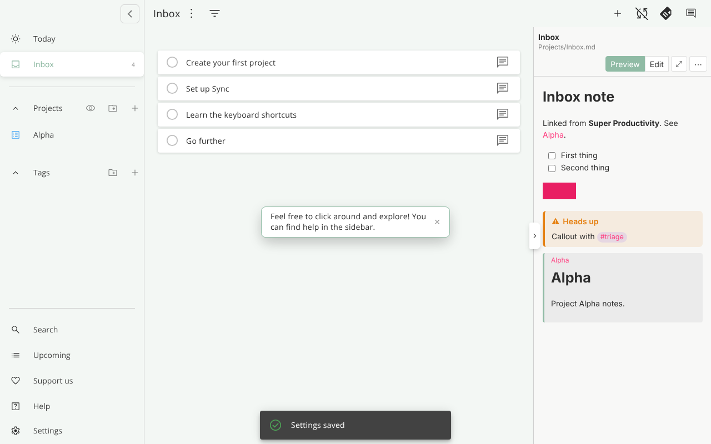
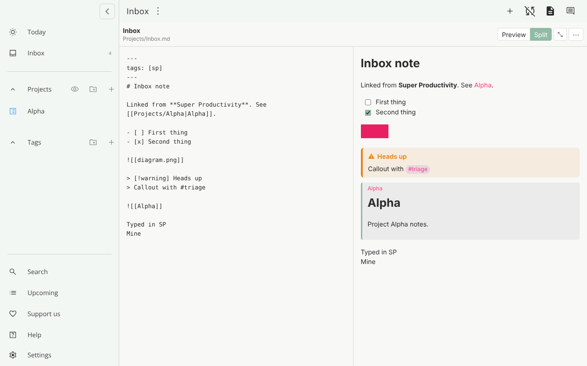
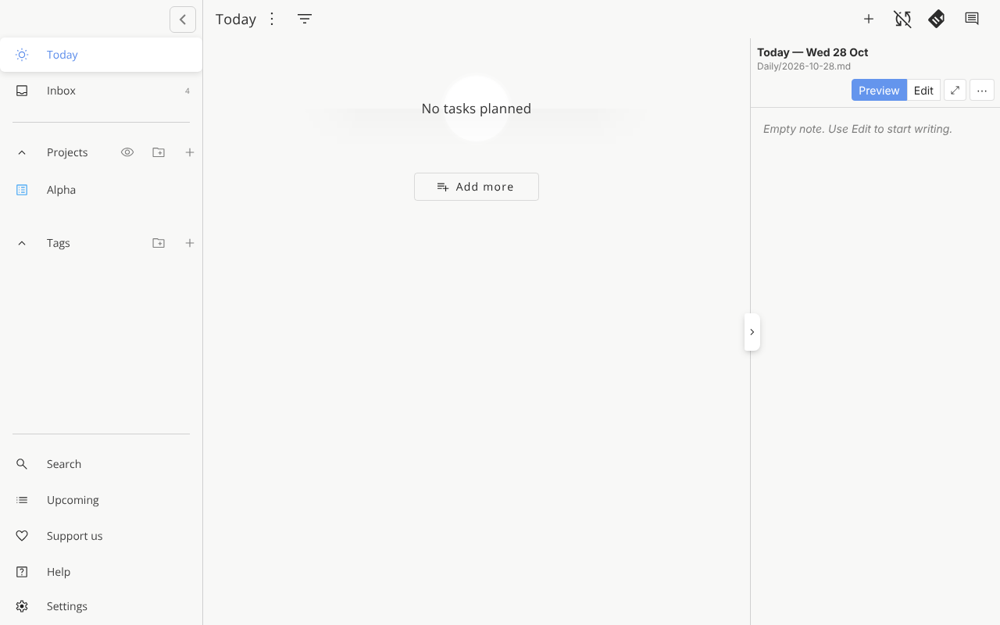

# Project Markdown Note

A [Super Productivity](https://github.com/super-productivity/super-productivity) plugin that links each project to **one markdown file on your computer** — for example a note in your Obsidian vault — and lets you read and edit it without leaving Super Productivity.

It replaces the built-in project notes with a real `.md` file, so the same note stays usable in Obsidian, any editor, and whatever sync you already use (iCloud, Dropbox, Git…).



## Features

- **One note per project.** Pick an existing `.md` file from a searchable tree of your vault, or paste its path. The panel follows whichever project you open.
- **Side panel and full page.** Preview or Edit in the side panel; Preview or Split (editor beside live preview) in the full page. One button (⤢ / ⤡) toggles between them.
- **Autosave with a conflict guard.** Saves about a second after you stop typing. If the file changes in another app while you have unsaved edits, it asks whether to keep yours or load the file's version; otherwise it reloads quietly.
- **Obsidian-flavoured preview**
  - `[[wikilinks]]` open the note in Obsidian
  - `![[Other note]]`, `![[Note#Heading]]` and `![[Note#^block-id]]` show the embedded note inline, as in Obsidian
  - `![[image.png]]` and relative images
  - callouts (`> [!tip]`, foldable `> [!warning]-`)
  - `#tags` (click to search the tag in Obsidian)
  - task checkboxes you can tick, written straight back to the file
  - frontmatter hidden
- **Daily note in Today.** The Today view shows today's daily note, using your Obsidian daily-notes settings (folder, date format, template) or your own. If it doesn't exist yet, one click creates it from the template.
- **Keyboard shortcuts.** Show/hide the side panel, full page on/off, and Preview/Edit. Assign keys in *Settings → Keyboard shortcuts → Plugin shortcuts*. Inside the note, `Ctrl/⌘+E` switches Preview/Edit and `Ctrl/⌘+S` saves.
- **Several computers.** Each computer stores its own vault folder; links are saved relative to it and sync through Super Productivity, so one link works everywhere.
- **Settings survive reinstalls.** Everything is also backed up to a file in your home folder and restored automatically. Export/Import is available too.

| Full page, Split | Daily note in Today |
|---|---|
|  |  |

## Requirements

- Super Productivity **desktop app** (macOS, Windows, Linux). The plugin reads and writes local files, which the web and mobile versions can't do.
- Tested on Super Productivity 18.1 and on current releases.

## Install

1. Download `project-markdown-note-<version>.zip` from [Releases](../../releases).
2. In Super Productivity open **Settings → Plugins → Choose Plugin File** and pick the zip.
3. Enable **Project Markdown Note**. When asked whether it may access your files, choose **Allow**. If you chose Deny, disable and re-enable the plugin to get the prompt again.
4. Open a project and click the note icon at the top right to open the side panel.
5. In **⋯ → Settings**, enter your vault (or notes) folder, e.g. `/Users/you/Obsidian/Main vault`, and save.
6. Pick the note for this project. Repeat step 5 once on each other computer.

### Updating

Upload the new zip over the installed plugin; your settings stay. If you press **Remove** first, Super Productivity deletes the plugin's saved settings. This plugin restores them from its backup file the next time it starts.

## Settings and backup

| Setting | Where it's stored |
|---|---|
| Vault folder | Per computer (keyed by computer name), synced with your Super Productivity data |
| Project → note links | Synced; relative to the vault folder |
| Obsidian vault name | Synced; defaults to the vault folder's name |
| Daily note folder / format / template | Synced; blank fields use `.obsidian/daily-notes.json` |
| Backup | `~/.sp-project-markdown-note.json` on each computer, updated on every change |

**Export settings…** and **Import settings…** in the Settings view copy everything as text, for moving to a new setup.

## Privacy and permissions

The plugin asks for Super Productivity's `nodeExecution` permission so it can run small, read-mostly scripts on your computer. Each script only uses Node's `fs`, `path` and `os` modules. It:

- reads the notes you link, notes you embed, and images they show
- lists `.md` and image files under your vault folder for the picker
- writes only to the linked note (or today's daily note), creates a daily note when you click Create, and writes its own backup file in your home folder

It makes no network requests. Links open in Obsidian or your browser through Super Productivity's normal link handling.

## Limitations

- Desktop only.
- One note per project. Tag views other than Today show a project picker.
- Notes over 2 MB aren't opened; images over 8 MB aren't previewed.
- Raw HTML in notes is shown as text, apart from simple tags such as `<br>`, `<u>`, `<mark>`, `<sub>`, `<sup>` and `<kbd>`; this keeps the preview safe.
- Embedded PDFs, audio and canvases are shown as links.

## How it works (for developers)

- `src/index.html` + `src/app.js` — the UI, rendered in the side panel and the full-page view.
- `src/plugin.js` — runs in the app: registers the keyboard shortcuts and shares the markdown library (`marked`) with the UI. Released app versions cap `index.html` at 100 KB, which the UI and `marked` together would exceed.
- `src/core.js` — markdown rendering (wikilinks, embeds, callouts, tags, safe HTML), task-checkbox offsets, daily-note dates, path helpers.
- `src/node-scripts.js` — the file-access scripts. They stay within what the app runs in-process (`fs`/`path`/`os` only), and values are passed as arguments, never pasted into code.

Beyond the documented plugin API, the plugin:
- uses `getActiveWorkContext()` and the `workContextChange` hook to follow the open project, with the app's route as a fallback for older versions
- uses `history.back()` to leave the full page
- shares `marked` through the app window, and finds its own panel button for the toggle-panel shortcut

Each of these is feature-detected or falls back gracefully.

### Build

```bash
npm install --ignore-scripts      # esbuild + marked
npm run build                     # → project-markdown-note-<version>.zip (flat, ready to upload)
```

### Test

```bash
npm test                                            # unit tests + file-script tests (Node ≥ 20)
pip install playwright && playwright install chromium
python3 test/browser/run_harness.py dist out        # UI against a mock host
python3 test/browser/live_flow.py dist out          # end-to-end on test-app.super-productivity.com
```

The browser tests drive the built plugin with real files in a temporary vault. The live test installs it in the public Super Productivity test app. That app is the web version, so a small test shim provides the file access.

## Licence

MIT © 2026 Jeng Long
